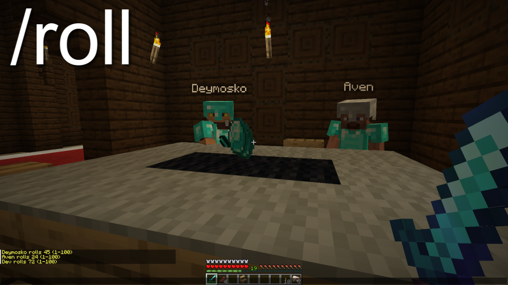
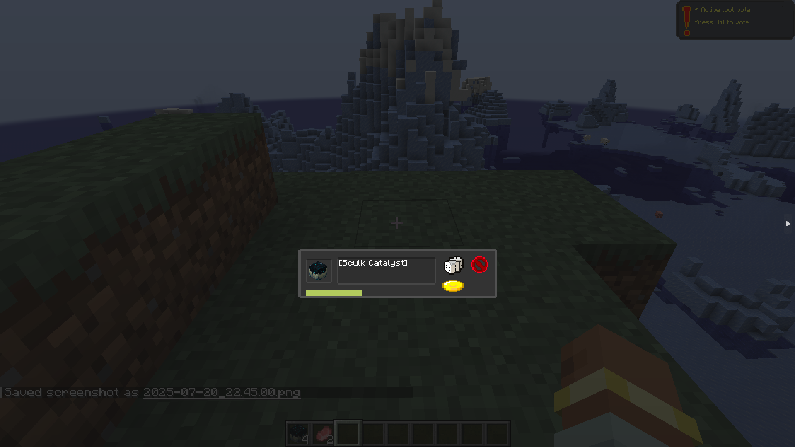
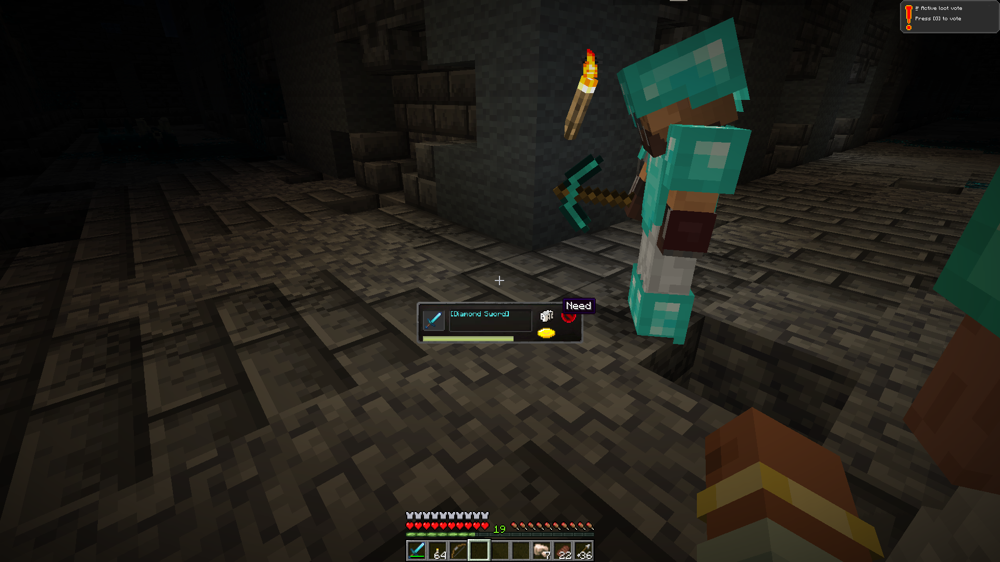
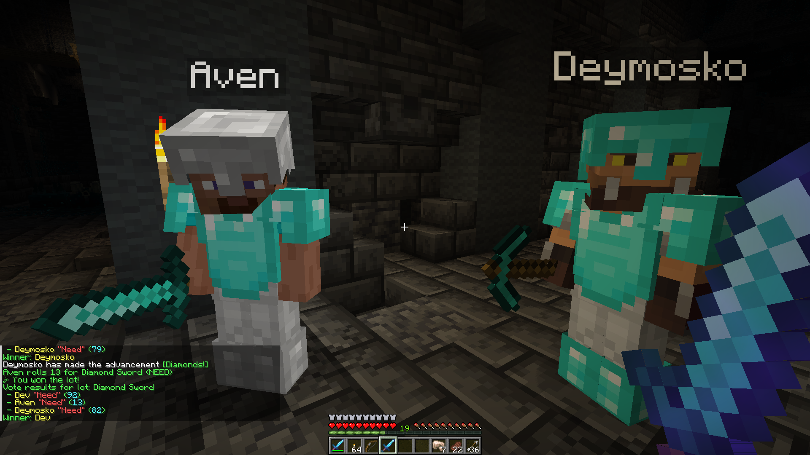

# 🎲 LootRoll

A Minecraft mod (1.20.1, **Forge and Fabric**) that adds a **Need / Greed / Pass** loot roll system inspired by classic MMORPGs like WoW or FFXIV.

---

## ✨ Features

- 🧍‍♂️ Loot of configured mobs (IDs, tags like `#forge:bosses`, or whole mods) goes to a roll instead of the ground
- 🐉 Works with bosses that drop loot their own way (after a death animation, spawned straight into the world): drops around a dying boss are captured automatically
- 📦 All of a mob's drops are gathered into one lot, then rolled per stack, per item, or as a whole
- 🎲 Highest roll wins: Need > Greed > Pass, ties are rerolled and announced
- 🖼️ WoW-style roll frames on the HUD with timers; vote with hotkeys without opening a screen
- 📜 Scrollable vote screen for many items at once, with "Need / Greed / Pass all"
- 💬 Clickable `[Need] [Greed] [Pass]` buttons in chat, so players without the mod can vote too
- 🛡️ Loot is never lost: offline winners get it on their next login, running rolls are resolved when the server stops
- ⚙️ Lots of server and client options

---

## 📦 Installation

Requires [Architectury API](https://modrinth.com/mod/architectury-api) on both loaders.

**Forge:** Forge 47+ for 1.20.1, Architectury API.
**Fabric:** Fabric Loader, Fabric API, Architectury API, [Forge Config API Port](https://modrinth.com/mod/forge-config-api-port).

Install on the server **and** the clients for the full UI. With the mod only on the server, players vote through chat buttons.

---

## ⌨️ Controls

| Key (default) | Action |
|---|---|
| `H` | Open the vote screen |
| `J` | Need on the top roll frame |
| `K` | Greed on the top roll frame |
| `N` | Pass on the top roll frame |

All keys can be rebound under *Controls → LootRoll*.

---

## 🧑‍💻 Commands

| Command | Description |
|---|---|
| `/startvote [count]` | Put the item in your main hand (or `count` of it) up for a roll among nearby players. If nobody wants it, it comes back to you. |
| `/roll` | Roll 1–100, shown to nearby players |
| `/roll <max>` | Roll 1–`max` |
| `/roll <min> <max>` | Roll `min`–`max` |
| `/lootroll vote <id> <need\|greed\|pass>` | Vote on a roll (used by the chat buttons) |

---

## 🌸 Configuration

### `config/lootroll-common.toml` (server)

```toml
[loot]
# Entity IDs, entity tags (#forge:bosses) or whole mods (alexscaves:*)
loot_entities = ["minecraft:warden", "minecraft:wither", "#forge:bosses"]
item_blacklist = []          # items that always drop normally
min_rarity = "COMMON"        # COMMON, UNCOMMON, RARE, EPIC
min_players = 1              # fewer eligible players -> loot just drops
vote_mode = "PER_STACK"      # PER_STACK, PER_ITEM, WHOLE_LOT
merge_identical_stacks = true
capture_nearby_drops = true  # catch bosses with custom drop logic
capture_radius = 4.0
capture_window = 30          # seconds

[vote]
vote_duration = 30
vote_radius = 100
require_line_of_sight = false
include_killer = true        # killer always takes part, even out of range
allow_greed = true
roll_min = 1
roll_max = 100
end_when_all_voted = true
pass_on_disconnect = true
no_winner_action = "DROP_ON_GROUND"        # or GIVE_RANDOM_PARTICIPANT
offline_winner_action = "DELIVER_ON_LOGIN" # or NEXT_HIGHEST_ROLL, DROP_ON_GROUND
chat_messages = "ALL"                      # ALL, RESULTS_ONLY, NONE
chat_vote_buttons = "CLIENTS_WITHOUT_MOD"  # ALWAYS, CLIENTS_WITHOUT_MOD, NEVER

[commands]
startvote_permission_level = 0
startvote_cooldown = 0
roll_radius = 100

[integrations]
dragon_loot_voting = true    # Ice and Fire dragon corpses
luxtructosaurus = true       # Alex's Caves
chaos_spawner = true         # Dungeon Now Loading
```

### `config/lootroll-client.toml` (each player)

```toml
[hud]
enabled = true
anchor = "CENTER_RIGHT"   # TOP_LEFT, TOP_CENTER, TOP_RIGHT, CENTER_LEFT, CENTER_RIGHT, BOTTOM_LEFT, BOTTOM_RIGHT
offset_x = 0
offset_y = 0
max_frames = 3
key_hints = true

[notifications]
play_sound = true
open_screen_on_vote = false
win_toast = true
```

---

## 🖼️ Screenshots

### 🔔 ```/roll``` command


---

### 🗳️```/startvote``` command, Loot Voting UI
Each item in a vote is shown with buttons:




---

## 🛠️ Building

```bash
./gradlew build
```

Jars end up in `forge/build/libs` and `fabric/build/libs`.

---

## 💬 Localization

English, Ukrainian and Russian are included. PRs for translations are welcome!

---

## ⚠️ License

MIT License – free to use, modify and distribute.
